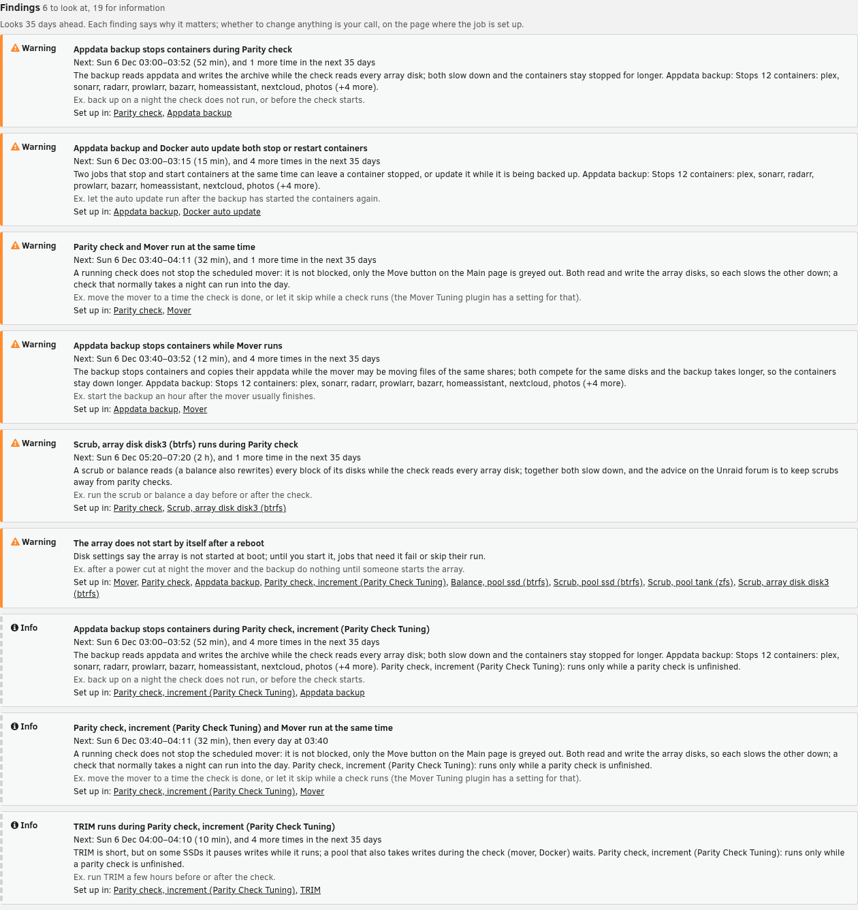
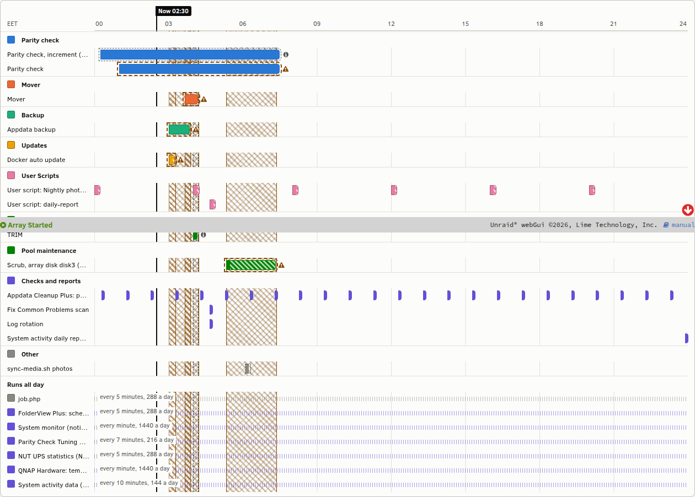
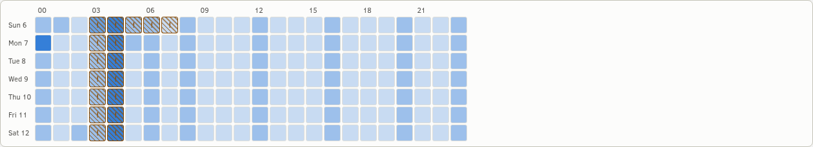
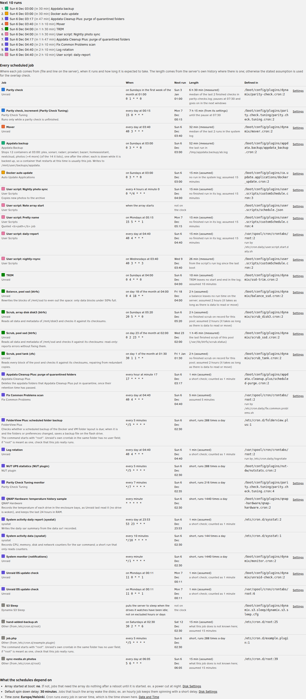

# Timetable for Unraid

Everything scheduled on your server in one place, and a warning when two jobs get in each other's way.

The parity check is set up on one page, the mover on another, TRIM on a third, and User Scripts, Appdata Backup, auto updates and other plugins each keep their own schedule. Nothing shows them side by side, so a mover run in the middle of a parity check, or a backup that stops your containers while the mover works, goes unnoticed until something is slow. Timetable reads all of them and shows them together.

It only reads. It never changes a setting, runs a job or schedules anything of its own; each job links to the page where you set it up.

Related: [Lookout](https://github.com/luuvasara/unraid-lookout) explains the errors in your logs.



## What it shows

Settings, Timetable:

- **Findings**: jobs that overlap where it matters, each with the reason and an example of what to do about it. For example:
  - the mover during a parity check (a running check does not stop the scheduled mover, so both slow down); with Mover Tuning set to skip the mover during a check, the finding says the run is skipped instead, and warns when a long check keeps the mover from running for days,
  - a parity check set to start on days close together, so it starts again soon after it finishes,
  - a pool or array-disk scrub or balance during a parity check, and a scrub and a balance of the same pool at once,
  - Appdata Backup stopping containers while the mover or a parity check runs, with the names of the containers it stops,
  - two jobs that stop or restart containers at the same time,
  - TRIM during a parity check,
  - a user script starting in the same minute as a heavy job,
  - a job that takes longer than the time between its runs,
  - many jobs starting together at the same minute,
  - jobs that need the array when the array is not started at boot,
  - a job that wakes the disks many times a day when they are set to spin down,
  - jobs that are due while S3 Sleep may have put the server to sleep, or that are still running when it may,
  - a schedule file on the flash drive that is not in the crontab, so it never runs, and a crontab line that is in no schedule file, so it is gone after the next rebuild,
  - the same command in two crontabs, so it runs twice.
- **Timeline**: the next 7 days, one row per job, from the start to the expected end. Overlaps are hatched. The week at a glance shows which hours are busy, and the runs later in the month list jobs that do not run every week, such as a monthly parity check.
- **List**: the next 10 runs, and every job with the file and line it comes from, when it runs, its next run and how long it takes.



## Where the schedules come from

| Job | Read from |
|---|---|
| Parity check, mover, TRIM, notifications and update checks | the crontab Unraid builds from the `.cron` files on the flash drive |
| Hourly, daily, weekly and monthly system jobs | the system crontab and `/etc/cron.hourly`, `.daily`, `.weekly`, `.monthly` |
| User Scripts | its `schedule.json`: custom schedules, the hourly to monthly ones, and "At Startup of Array" and the other array events |
| Appdata Backup | its cron file and settings: which containers it stops and where it writes |
| Auto Update Applications, Fix Common Problems, Parity Check Tuning, Dynamix SSD Trim | their cron files |
| Mover Tuning | its cron files, and whether it lets the scheduled mover run during a parity check |
| Dynamix S3 Sleep, Dynamix System Autofan | their settings |
| QNAP Hardware, FolderView Plus, sysstat | their cron lines |
| Anything else in the crontab | shown as "Other", with the file it comes from |

## How long a job takes

An overlap depends on how long each job runs, so Timetable takes the length from the server's own history where there is one:

- parity check: the last finished checks in the parity check history,
- mover: its start and finish lines in the system log,
- Appdata Backup and User Scripts: their own run logs.

Where there is no history, the list says which length was assumed, and the timeline draws it hatched (estimated) or with a dashed outline (not known). Times are the server's time, the time cron uses.





The screenshots show example data.

## Not covered yet

Clock changes for daylight saving time. Unraid's cron (dcron 4.5) matches each line against the local wall clock, so a job set between about 02:00 and 04:00 can run twice on the night the clocks go back and not at all on the night they go forward (the exact hour depends on the time zone). Timetable draws every day as 24 hours and does not point this out yet. Until it does: keep jobs that must run exactly once a day outside that hour.

## Install

Unraid 6.12 or later. In the Plugins tab, Install Plugin:

```
https://raw.githubusercontent.com/luuvasara/unraid-timetable/main/unraid-timetable.plg
```

## Support

Questions and bugs: [GitHub issues](https://github.com/luuvasara/unraid-timetable/issues).

## Licence

GPL-2.0, see [LICENSE](LICENSE).
